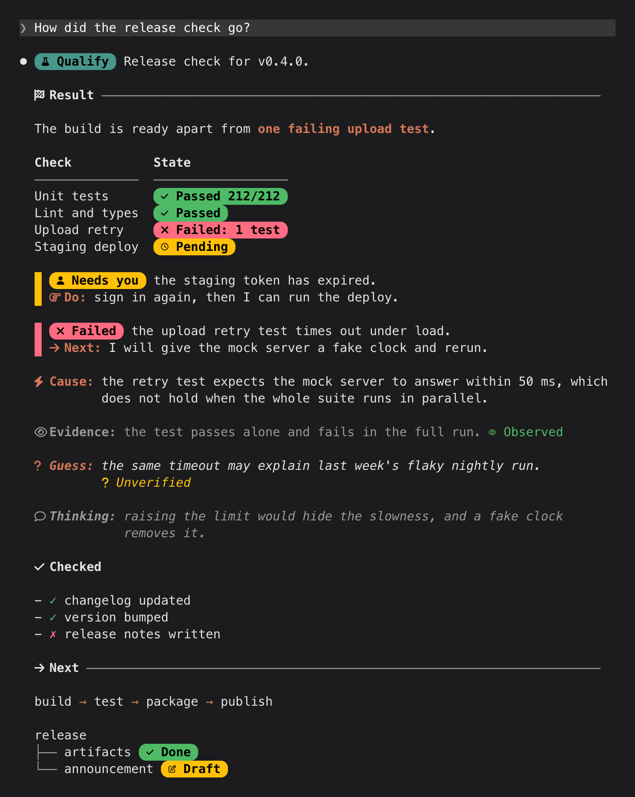
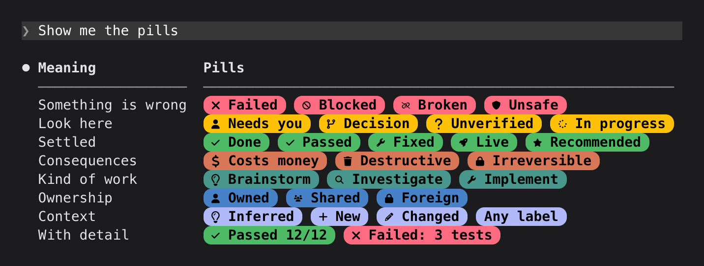

# claude-emphasis

A Claude Code mod that makes replies easier to scan in the terminal. It draws `[[Done]]`, `[[Failed]]` and `[[Needs you]]` as colored pills with icons, gives known headings and lead labels an icon, colors bold text, and colors `✓`, `✗`, `→` and tree lines. It also gives each part of a reply the weight of its role: an ask or a problem becomes a block with a colored bar, evidence is dim, a guess is italic, and working notes are dim and italic.



It changes only what is drawn. Stored messages and copied text keep the original Markdown. Code blocks, inline code, quotes and replies with nothing to decorate are drawn by Claude Code as usual.

The idea, the pill vocabulary and the icon tables come from [pi-emphasis](https://github.com/johnlindquist/pi-emphasis) by John Lindquist, which does the same for Pi.

## Requirements

- Claude Code with function hooks. Checked on 2.1.326, in the terminal only. Other surfaces keep their normal drawing.
- A terminal font with [Nerd Font](https://www.nerdfonts.com/) symbols, for the icons and the rounded pill ends. Without one, turn both off in `/config`.

## Install

At the prompt of a terminal session:

```
/plugin install emphasis --marketplace kristalalfred/claude-emphasis
```

From a shell:

```sh
claude plugin install emphasis --marketplace kristalalfred/claude-emphasis
```

Answer `y` to add the marketplace, then choose a scope.

## Tell the model to write them

The mod draws pills but does not ask the model to write them. Copy [`rules/emphasis.md`](rules/emphasis.md) into your own instructions so every session gets the rules:

```sh
mkdir -p ~/.claude/rules
curl -fsSL https://raw.githubusercontent.com/kristalalfred/claude-emphasis/main/rules/emphasis.md -o ~/.claude/rules/emphasis.md
```

The rules are a file and not part of the mod because an organization's policy can skip a personal mod's hooks on the system prompt.

## Pills

The word decides the color and the icon. A known word may carry detail, such as `[[Passed 12/12]]` or `[[Failed: 3 tests]]`. A label can be up to 32 characters.



| Color | Meaning | Words |
|---|---|---|
| Red | Something is wrong | Failed, Blocked, Broken, Unsafe, Rejected, Down |
| Yellow | Look here | Needs you, Decision, Unverified, Partial, Skipped, In progress, Pending, At risk, Review, Todo, Stale, Draft |
| Green | Settled | Done, Passed, Observed, Fixed, Live, Recommended, Keep, Ready, Merged, Safe, Verified, Shipped, Approved, Healthy |
| Orange | Consequences | Costs money, Destructive, Irreversible |
| Teal | Kind of work | Brainstorm, Investigate, Preview, Implement, Qualify |
| Blue | Ownership | Owned, Shared, Foreign |
| Soft blue | Context | Inferred, New, Changed, Optional, and any other label |

Colors come from your Claude Code theme.

## Roles

What opens a paragraph or list item sets how all of it is drawn. Lines indented under it belong to it.

| Opens with | Role | Drawn as |
|---|---|---|
| `[[Needs you]]`, `[[Decision]]` or an orange pill | Ask | A block with a bar in the pill's color, its `**Do:**` on a line of its own |
| A red pill | Problem | The same block, in red |
| `**Evidence:**` | Evidence | Dim |
| `**Guess:**` | Speculation | Italic |
| `**Thinking:**` | Working notes | Dim and italic |
| Anything else | Statement | Full strength |

`[[Observed]]`, `[[Inferred]]` and `[[Unverified]]` grade a claim, so they are drawn as colored tags with no fill. Text after a known label such as `**Cause:**` wraps in line with itself, not under the label. The first two heading levels carry a rule.

## Settings

In `/config`:

- **Icons**: Nerd Font icons in pills and on labels.
- **Rounded pills**: Nerd Font half circles at each end of a pill.
- **Bold color**: a theme key or raw color for bold text. The default is `claude`.

## Development

```sh
just check   # validate, test, and confirm rules/emphasis.md is current
just rules   # regenerate rules/emphasis.md from hooks/vocabulary.ts
```
